# Лабораторная работа №7 - Преобразование и анализ кода с использованием Clang и LLVM

## Цель работы
Познакомиться с инструментами Clang и LLVM, научиться собирать AST и IR-промежуточное представление кода на C/C++, а также извлекать базовую информацию о программе (например, список функций).

## Автор
+ Башинов Арья Игоревич
+ Группа: АП-326

## Постановка задачи

### Общее задание
Необходимо установить Clang, LLVM, opt и Graphviz, получить AST и LLVM IR для C-файла, применить оптимизацию -O2, построить CFG, сравнить результаты до и после оптимизации.

### Индивидуальное задание
Вариант 2.2 - Структуры / записи.

Необходимо:
+ Получить AST и LLVM IR для кода со структурой.
+ Применить -O2 и описать, изменилась ли передача структуры (по значению / по ссылке).
+ Построить CFG для функций `sum` и `main`.
+ Исследовать, что происходит при добавлении `__attribute__((always_inline))` к `sum`.
+ Сделать вывод о том, как LLVM оптимизирует передачу структур.

## Установка и подготовка среды

Работа выполнялась в Ubuntu 26.04 LTS через Oracle VirtualBox на Windows.

Установка инструментов:
```bash
sudo apt update
sudo apt install clang llvm graphviz
```

Проверка версий:
```bash
clang --version
opt --version
dot -V
```

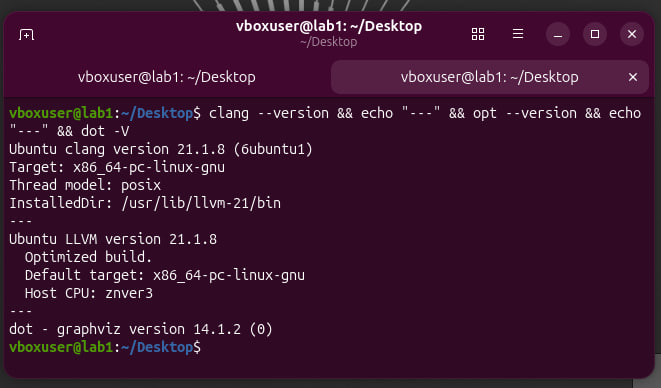

## Общая часть

### Исходный код

Файл `common/main.c`:
```c
#include <stdio.h>

int square(int x) {
    return x * x;
}

int main() {
    int a = 5;
    int b = square(a);
    printf("%d\n", b);
    return 0;
}
```

### Получение AST

Команда:
```bash
clang -Xclang -ast-dump -fsyntax-only main.c > main_ast.txt
```

Фрагмент AST с функцией `square`:

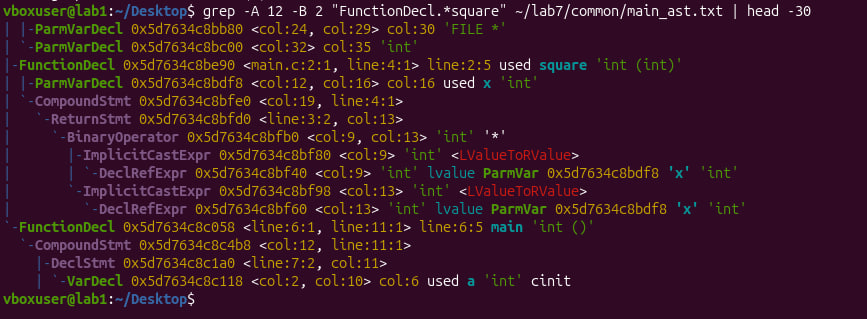

В AST видно:
- `FunctionDecl ... square 'int (int)'` - объявление функции `square`, которая принимает `int` и возвращает `int`.
- `ParmVarDecl ... x 'int'` - параметр `x` типа `int`.
- `BinaryOperator ... '*' 'int'` - операция умножения внутри `square`.

### Генерация LLVM IR без оптимизаций (-O0)

Команда:
```bash
clang -O0 -S -emit-llvm -c main.c -o main_O0.ll
```

IR функции `main`:
```
define dso_local i32 @main() #0 {
  %1 = alloca i32, align 4
  %2 = alloca i32, align 4
  %3 = alloca i32, align 4
  store i32 0, ptr %1, align 4
  store i32 5, ptr %2, align 4
  %4 = load i32, ptr %2, align 4
  %5 = call i32 @square(i32 noundef %4)
  store i32 %5, ptr %3, align 4
  %6 = load i32, ptr %3, align 4
  %7 = call i32 (ptr, ...) @printf(ptr noundef @.str, i32 noundef %6)
  ret i32 0
}
```

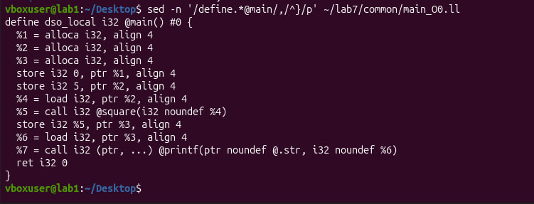

В IR без оптимизаций видно:
- **`alloca`** - переменные размещаются в стеке (`a`, `b`).
- **`store` и `load`** - постоянные обращения к памяти.
- **`call @square`** - вызов функции **не встроен**, происходит реальный переход.
- Переменные **не в SSA-форме**.

### Генерация LLVM IR с оптимизацией -O2

Команда:
```bash
clang -O2 -S -emit-llvm -c main.c -o main_O2.ll
```

IR функции `main`:
```
define dso_local noundef i32 @main() local_unnamed_addr #1 {
  %1 = tail call i32 (ptr, ...) @printf(ptr noundef nonnull dereferenceable(1) @.str, i32 noundef 25)
  ret i32 0
}
```

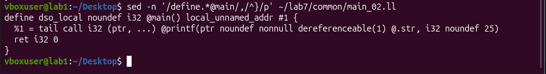

В IR после оптимизации:
- **Функция `square` отсутствует** - она встроена (`-inline`).
- **Значение `5 * 5 = 25` вычислено на этапе компиляции** (`-constprop`).
- **Все `alloca`, `store`, `load` удалены** (`-mem2reg`).
- Остался **только вызов `printf(25)`**.

### Сравнение IR

Команда:
```bash
diff -u main_O0.ll main_O2.ll > main_diff.txt
```

Ключевые различия:
- Функция `square`: было 6 инструкций, стало 2 (`mul` и `ret`).
- Функция `main`: было 10 строк, стало 2.
- Все `alloca` и `load`/`store` удалены.
- Значение `5 * 5` подставлено константой.

### Граф потока управления

Команда для генерации CFG:
```bash
opt-18 -passes=dot-cfg -disable-output main_O2.ll
dot -Tpng .main.dot -o cfg_main.png
dot -Tpng .square.dot -o cfg_square.png
```

CFG функции `main` после -O2:


CFG функции `square` после -O2:

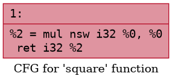

При -O2 граф потока управления упрощается до одного базового блока - условных переходов нет.

### Вывод по общей части

Оптимизация -O2 значительно упрощает IR. Компилятор применяет:
- **`-inline`** - встраивание маленьких функций.
- **`-constprop`** - подстановка вычисленных констант.
- **`-mem2reg`** - перевод переменных из памяти в регистры (SSA-форма).
- **`-simplifycfg`** - упрощение графа потока управления.

В IR после оптимизации не остаётся лишних обращений к памяти и вызовов функций, которые можно встроить.


## Индивидуальное задание - Вариант 2.2. Структуры / записи

### Исходный код

Файл `variant_2_2/struct.c`:
```c
#include <stdio.h>

struct Point {
    int x;
    int y;
};

int sum(struct Point p) {
    return p.x + p.y;
}

int main() {
    struct Point p = {2, 3};
    int result = sum(p);
    printf("%d\n", result);
    return 0;
}
```

### Получение AST

Команда:
```bash
clang -Xclang -ast-dump -fsyntax-only struct.c > struct_ast.txt
```

Фрагмент AST с функцией `sum`:

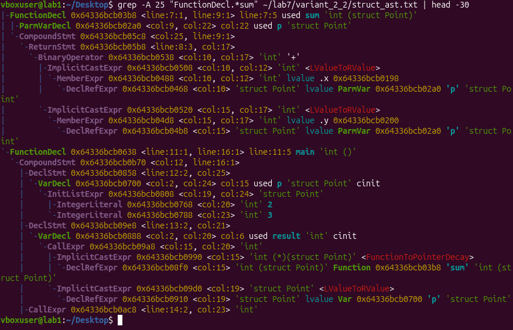

В AST видно:
- `RecordDecl ... struct Point definition` - определение структуры.
- `FieldDecl ... x 'int'` и `FieldDecl ... y 'int'` - поля структуры.
- `FunctionDecl ... sum 'int (struct Point)'` - функция `sum`, принимает `struct Point`.
- `ParmVarDecl ... p 'struct Point'` - параметр `p`.
- `MemberExpr ... .x 'int'` - доступ к полю `x` через точку.
- В `main`: `InitListExpr` с `IntegerLiteral 2` и `IntegerLiteral 3` - инициализация `{2, 3}`.

### Генерация LLVM IR без оптимизаций (-O0)

Команда:
```bash
clang -O0 -S -emit-llvm -c struct.c -o struct_O0.ll
```

IR функции `sum` и `main`:

```
%struct.Point = type { i32, i32 }

define dso_local i32 @sum(i64 %0) #0 {
  %2 = alloca i64, align 4
  store i64 %0, ptr %2, align 4
  %3 = getelementptr inbounds %struct.Point, ptr %2, i32 0, i32 0
  %4 = load i32, ptr %3, align 4
  %5 = getelementptr inbounds %struct.Point, ptr %2, i32 0, i32 1
  %6 = load i32, ptr %5, align 4
  %7 = add nsw i32 %4, %6
  ret i32 %7
}

define dso_local i32 @main() #0 {
  %1 = alloca i32, align 4
  %2 = alloca %struct.Point, align 4
  store i32 0, ptr %1, align 4
  call void @llvm.memcpy.p0.p0.i64(ptr align 4 %2, ptr align 4 @__const.main.p, i64 8, i1 false)
  %4 = load i64, ptr %2, align 4
  %5 = call i32 @sum(i64 %4)
  store i32 %5, ptr %1, align 4
  %6 = load i32, ptr %1, align 4
  %7 = call i32 (ptr, ...) @printf(ptr noundef @.str, i32 noundef %6)
  ret i32 0
}
```

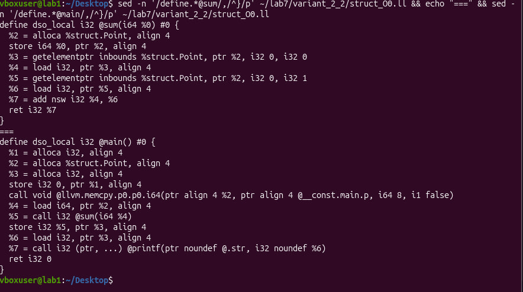

**Ключевое наблюдение:** функция `sum` принимает **`i64 %0`**, а не `%struct.Point` и не указатель. Это значит, что LLVM **упаковал структуру** `Point` (2 поля по 32 бита = 64 бита) в **один 64-битный регистр**.

Внутри `sum` структура **распаковывается** через `getelementptr` - берётся адрес первого поля (`x`), потом второго (`y`), оба поля загружаются через `load`.

### Генерация LLVM IR с оптимизацией -O2

Команда:
```bash
clang -O2 -S -emit-llvm -c struct.c -o struct_O2.ll
```

IR функции `sum` и `main`:

```
define dso_local i32 @sum(i64 %0) local_unnamed_addr #0 {
  %2 = trunc i64 %0 to i32
  %3 = lshr i64 %0, 32
  %4 = trunc i64 %3 to i32
  %5 = add nsw i32 %4, %2
  ret i32 %5
}

define dso_local noundef i32 @main() local_unnamed_addr #1 {
  %1 = tail call i32 (ptr, ...) @printf(ptr noundef nonnull dereferenceable(1) @.str, i32 noundef 5)
  ret i32 0
}
```

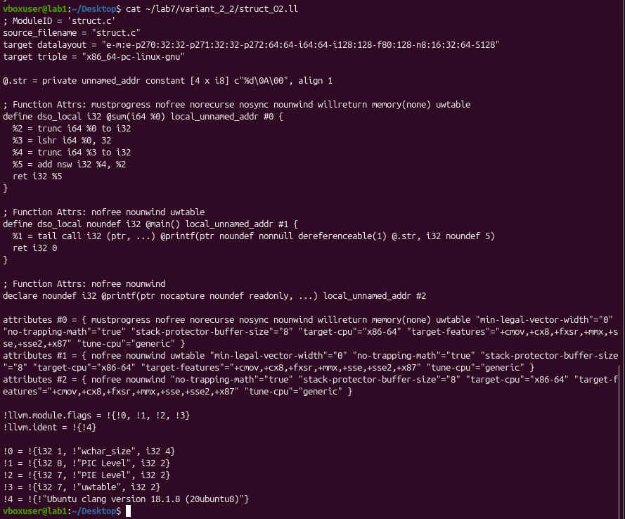

**Что произошло:**
- Структура **по-прежнему упакована в `i64`** - способ передачи **не изменился**.
- Внутри `sum` теперь **нет `getelementptr`, `load`, `alloca`, `store`** - вместо этого **распаковка через битовые операции**:
  - `trunc i64 to i32` - младшие 32 бита (`x`).
  - `lshr i64 %0, 32` + `trunc` - старшие 32 бита (`y`).
- Функция `main` превратилась в **одну строку**: `printf(5)`.
- **Функция `sum` встроена** в `main` - вызова `@sum` больше нет.
- **Значение `2 + 3 = 5` вычислено на этапе компиляции**.

### Сравнение IR -O0 и -O2

Ключевые различия:

| Оптимизация | Что произошло |
| --- | --- |
| `-inline` | Функция `sum` встроена в `main` |
| `-constprop` | Значение `2 + 3 = 5` вычислено на этапе компиляции |
| `-mem2reg` | Переменные переведены в SSA-форму, `alloca`/`store`/`load` удалены |
| `-instcombine` | `getelementptr` заменены на битовые операции (`trunc`, `lshr`) |

### Анализ передачи структуры

**До оптимизации (-O0):**
- Структура `Point` передаётся в `sum` **по значению**.
- На уровне IR LLVM **упаковал** её в **один 64-битный регистр** `i64`.
- Внутри функции - распаковка через `getelementptr` (доступ к полям по адресу).

**После оптимизации (-O2):**
- Способ передачи **не изменился** - структура всё ещё упакована в `i64`.
- Но функция `sum` **встроена** в `main`, значение **вычислено на этапе компиляции**.
- Передача структуры как таковая **исчезла** - компилятор просто подставил результат.

**Ответ на вопрос задания: LLVM не переходит на передачу структуры по ссылке.** Вместо этого:
- Маленькие структуры (≤ 16 байт) **упаковываются в регистры** и передаются по значению.
- При оптимизации компилятор либо **встраивает функцию**, либо **распаковывает структуру на отдельные поля**.

### Граф потока управления

Команда:
```bash
opt-18 -passes=dot-cfg -disable-output struct_O2.ll
dot -Tpng .main.dot -o cfg_struct_main.png
dot -Tpng .sum.dot -o cfg_struct_sum.png
```

CFG функции `main` после -O2:

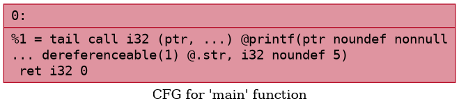

CFG функции `sum` после -O2:

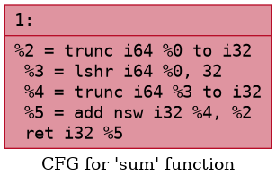

Графы стали **минимальными** - по одному базовому блоку на функцию, без условных переходов.

### Исследование __attribute__((always_inline))

Файл `variant_2_2/struct_inline.c`:
```c
#include <stdio.h>

struct Point {
    int x;
    int y;
};

__attribute__((always_inline))
static inline int sum(struct Point p) {
    return p.x + p.y;
}

int main() {
    struct Point p = {2, 3};
    int result = sum(p);
    printf("%d\n", result);
    return 0;
}
```

Команда:
```bash
clang -O2 -S -emit-llvm -c struct_inline.c -o struct_inline_O2.ll
```

IR:
```
define dso_local noundef i32 @main() local_unnamed_addr #0 {
  %1 = tail call i32 (ptr, ...) @printf(ptr noundef nonnull dereferenceable(1) @.str, i32 noundef 5)
  ret i32 0
}
```

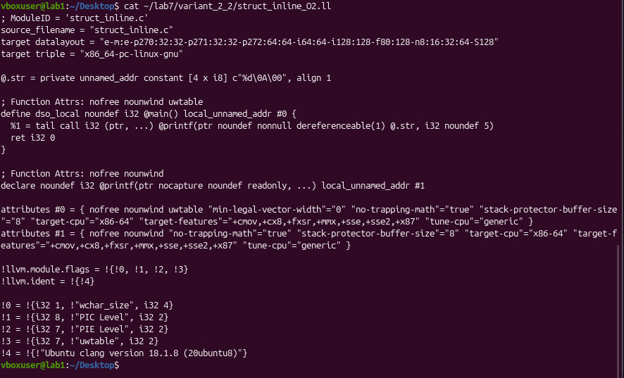

**Функция `sum` полностью исчезла** - остался только `main` с вызовом `printf(5)`.

**Вывод по `always_inline`:**
- Атрибут **гарантирует встраивание** функции, независимо от её размера и уровня оптимизации.
- В нашем случае это привело к **полному устранению функции `sum`** из IR.
- Результат **идентичен** обычной `-O2` оптимизации, но гарантированно (без атрибута встраивание было бы **вероятностным**).

### CFG для версии с always_inline


CFG содержит **один базовый блок** - никаких вызовов, никаких переходов.

### Вывод по индивидуальному заданию

1. **AST** показывает структуру `Point` как `RecordDecl` с двумя полями `x` и `y`, функцию `sum` с параметром типа `struct Point`, и доступ к полям через `MemberExpr`.

2. **LLVM IR** без оптимизаций демонстрирует **упаковку структуры в `i64`** - LLVM использует ABI-специфику x86-64: структуры размером до 16 байт передаются **в регистрах, упакованными**.

3. **Оптимизация -O2**:
   - Встраивает `sum` в `main`.
   - Вычисляет значение на этапе компиляции.
   - Переводит код в SSA-форму.
   - Заменяет `getelementptr` на битовые операции.

4. **`__attribute__((always_inline))`** гарантирует встраивание, что приводит к полному исчезновению функции из IR.

5. **Ответ на главный вопрос:** LLVM **не переходит на передачу структуры по ссылке**. Маленькие структуры передаются по значению, упакованными в регистры. При оптимизации либо встраивается вызывающая функция, либо структура распаковывается на отдельные поля.


## Ответы на контрольные вопросы

### 1. Что такое Clang, и какова его роль в процессе компиляции программ?
Clang - это компилятор языков C, C++ и Objective-C, построенный на инфраструктуре LLVM. Он выполняет лексический и синтаксический анализ исходного кода, строит абстрактное синтаксическое дерево (AST), проверяет корректность программы с точки зрения языка и генерирует промежуточное представление LLVM IR. Clang также используется как frontend для инструментов статического анализа, рефакторинга и генерации кода.

### 2. Что представляет собой LLVM и как он используется в современных компиляторах?
LLVM - это инфраструктура для построения компиляторов и инструментов анализа программ. Она предоставляет:
- единое промежуточное представление (LLVM IR);
- набор оптимизаций, работающих над IR;
- средства генерации машинного кода для множества архитектур (x86, ARM, RISC-V и др.).

Современные компиляторы (Clang, Rust, Swift, Julia) используют LLVM как backend: разные языки генерируют один и тот же LLVM IR, а оптимизации и кодогенерация выполняются универсально.

### 3. Чем отличается AST от промежуточного представления LLVM IR?
**AST** близок к исходному тексту и отражает синтаксическую структуру языка: выражения, объявления, операторы, ветвления. Он зависит от синтаксиса конкретного языка.

**LLVM IR** находится на более низком уровне абстракции. Он не зависит от исходного языка и описывает программу в виде трёхадресных инструкций, базовых блоков, переходов (`br`), вызовов функций, загрузок (`load`) и сохранений (`store`). IR удобен для анализа и оптимизации, потому что имеет строго определённую семантику.

### 4. Для чего необходимо промежуточное представление (IR) в процессе компиляции?
IR отделяет frontend (разбор исходного языка) от backend (оптимизации и генерация машинного кода). Это даёт:
- независимость оптимизаций от языка программирования;
- возможность повторного использования оптимизаций для разных языков;
- удобную формальную модель для анализа и преобразования программы;
- упрощение кодогенерации под разные архитектуры.

### 5. Что делает инструкция alloca в LLVM IR, и зачем она используется в функциях?
Инструкция `alloca` выделяет память в **стековом кадре функции**. Она используется для локальных переменных и параметров, которые должны иметь адрес. На уровне `-O0` компилятор активно использует `alloca`, чтобы сохранить структуру программы близкой к исходному коду. При оптимизации (`-O2`) `alloca` обычно удаляются с помощью `-mem2reg`, а переменные переводятся в SSA-форму в регистрах.

### 6. Зачем нужна оптимизация кода в компиляторе, и какие основные цели она преследует?
Оптимизация улучшает характеристики программы:
- **скорость выполнения** (уменьшение количества инструкций, встраивание функций);
- **размер кода** (удаление мёртвого кода, объединение констант);
- **эффективность работы с памятью** (перевод переменных в регистры);
- **упрощение потока управления** (свёртка условий, удаление недостижимых блоков).

Оптимизации делятся на машинно-независимые (на уровне IR) и машинно-зависимые (на уровне инструкций целевой архитектуры).

### 7. Что такое SSA-форма и почему она важна при оптимизации программ?
**SSA (Static Single Assignment)** - форма представления программы, в которой **каждое значение присваивается ровно один раз**. Если переменная изменяется, создаётся новая версия этой переменной (`%1`, `%2`, `%3`...).

SSA-форма важна потому что:
- упрощает анализ зависимостей между значениями;
- делает явными потоки данных;
- позволяет эффективно применять оптимизации (удаление мёртвого кода, распространение констант, свёртку);
- позволяет корректно обрабатывать ветвления через `phi`-узлы.

### 8. Что такое граф потока управления (CFG) и как он помогает анализировать поведение программы?
**CFG** - это ориентированный граф, где:
- **вершины** - базовые блоки (последовательности инструкций без переходов);
- **рёбра** - возможные переходы между блоками.

CFG помогает:
- анализировать ветвления, циклы, порядок выполнения;
- находить недостижимый код;
- оптимизировать поток управления;
- строить другие анализы (доминирование, анализ живых переменных).

### 9. Как устроено представление арифметических операций в LLVM IR (например, умножение, сложение)?
Арифметические операции представлены отдельными **инструкциями**:
- `add` - сложение;
- `sub` - вычитание;
- `mul` - умножение;
- `sdiv`/`udiv` - деление со знаком / без знака;
- `srem`/`urem` - остаток от деления.

У каждой инструкции указывается тип, флаги (`nsw` - no signed wrap, `nuw` - no unsigned wrap) и два операнда. Сравнения представлены через `icmp` (для целых) и `fcmp` (для чисел с плавающей точкой).

### 10. Почему функции в LLVM IR обычно представляют собой отдельные единицы анализа и оптимизации?
Функция имеет **собственные параметры**, **локальные переменные**, **базовые блоки** и **свой CFG**. Это делает её естественной единицей для анализа и оптимизации. Внутри функции можно применять локальные оптимизации (SSA, удаление мёртвого кода, свёртка констант), а на уровне межпроцедурных оптимизаций (`-inline`, `-ipsccp`) функции анализируются уже как единое целое.

### 11. Что происходит с функцией в LLVM IR, если она вызывается один раз и очень короткая?
Такая функция обычно **встраивается** в место вызова - это оптимизация **inline**. После встраивания функция может полностью исчезнуть из IR, а её код - превратиться в подстановку результата. Например, в нашей работе `sum(Point{2, 3})` после `-O2` превратилась в `printf(5)`: функция `sum` была встроена в `main`, а значение `2 + 3 = 5` вычислено на этапе компиляции.

### 12. Какие преимущества даёт использование IR и CFG для автоматических оптимизаций по сравнению с анализом исходного текста на С?
IR и CFG дают:
- **формальную и однозначную структуру**, независимую от синтаксиса конкретного языка;
- **унифицированное представление** для разных языков и архитектур;
- **простые модели анализа** (SSA, доминирование, потоки данных);
- **надёжность** - оптимизации проверены на миллионах программ;
- **расширяемость** - легко добавить новый язык через frontend, не меняя backend.

Анализ исходного текста был бы вынужден учитывать всю сложность синтаксиса C, включая макросы, неоднозначности и контекстно-зависимые правила.

## Общий вывод

В ходе лабораторной работы были установлены инструменты Clang, LLVM, opt и Graphviz. С их помощью:
- Получено **AST** для программ на C.
- Сгенерирован **LLVM IR** в двух вариантах: без оптимизаций (`-O0`) и с оптимизацией `-O2`.
- Построены **графы потока управления** (CFG) для функций.
- Проведён **анализ индивидуального задания** по структурам (вариант 2.2).

Основные выводы:
1. Оптимизация `-O2` существенно упрощает IR: удаляет `alloca`, `load`, `store`, встраивает функции, вычисляет константы на этапе компиляции.
2. LLVM **упаковывает маленькие структуры** (≤ 16 байт) в регистры при передаче по значению. Это соответствует ABI x86-64.
3. LLVM **не переходит на передачу структуры по ссылке**. Вместо этого он либо встраивает функцию, либо распаковывает структуру на отдельные поля.
4. `__attribute__((always_inline))` гарантирует встраивание, что приводит к полному исчезновению функции из IR.
5. Разные синтаксические конструкции языка C могут быть приведены к **единой промежуточной форме** - это ключевое преимущество IR для оптимизаций и анализа программ.